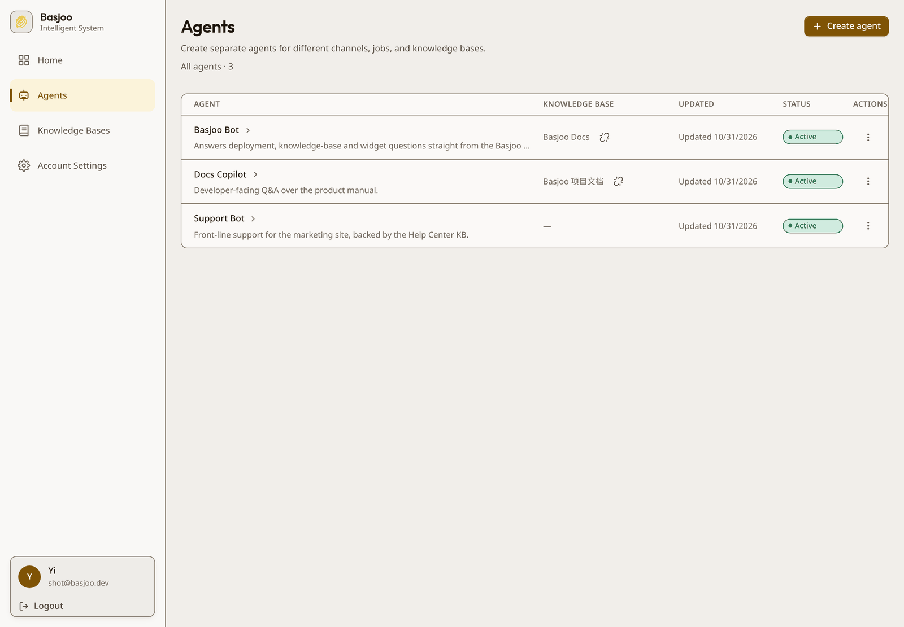
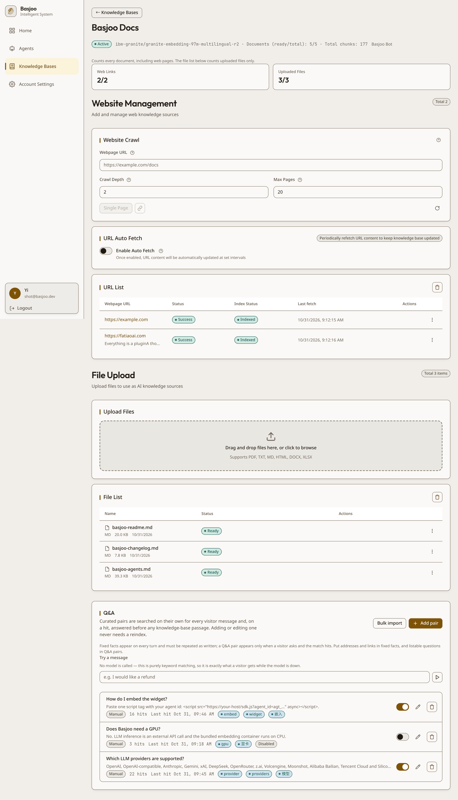
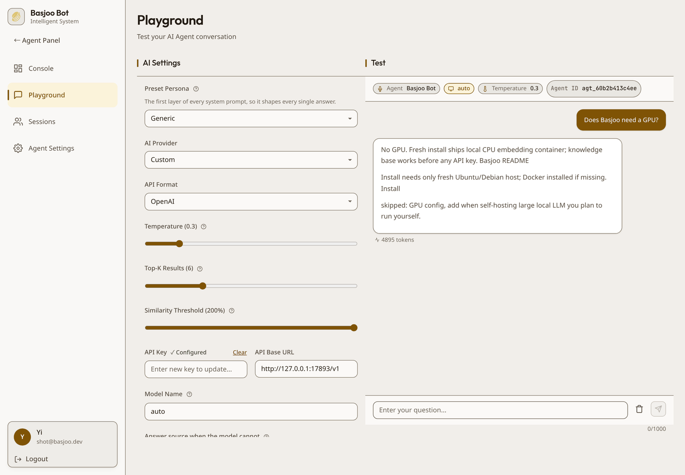
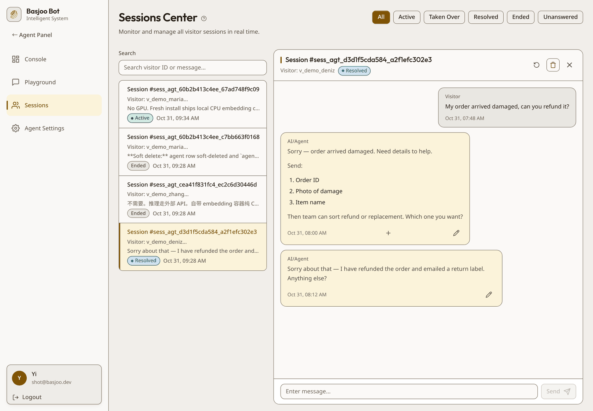
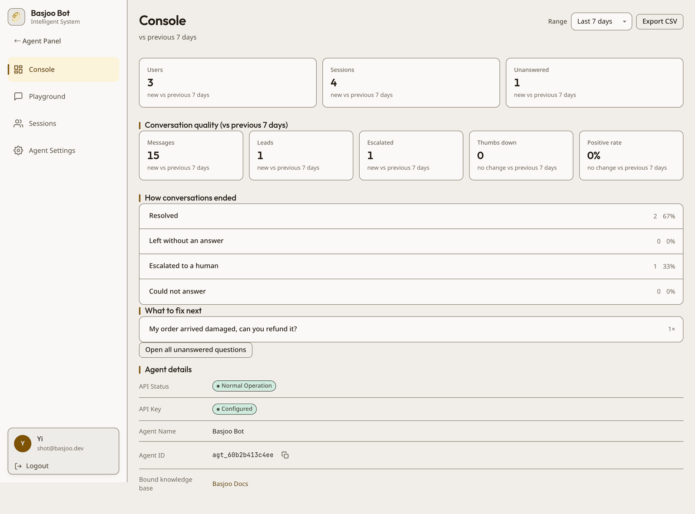
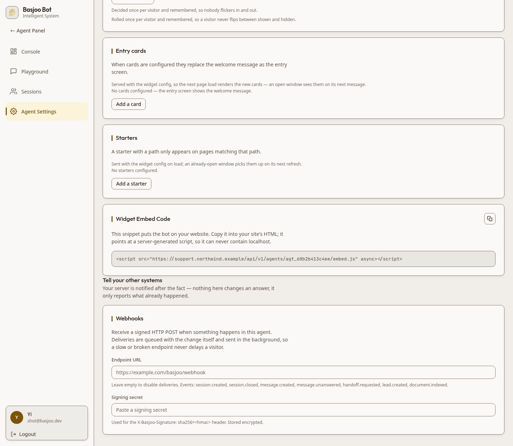
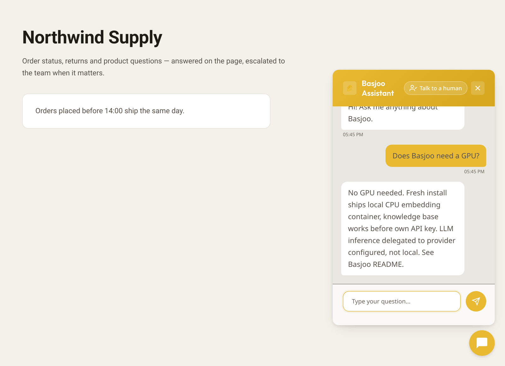

<p align="center"></p>

<h1 align="center">Basjoo</h1>

<p align="center">
<a href="https://www.docker.com/"></a>
<a href="https://fastapi.tiangolo.com/"></a>
<a href="https://vite.dev/"></a>
<a href="https://react.dev/"></a>
<a href="https://www.python.org/"></a>
<a href="https://www.typescriptlang.org/"></a>
<a href="https://www.sqlite.org/"></a>
<a href="https://qdrant.tech/"></a>
<a href="LICENSE"></a>
</p>

<p align="center">English | <a href="README.zh-CN.md">简体中文</a></p>

Basjoo is a self-hosted AI customer-support platform: it turns a website plus a set of documents into a
support agent you can embed anywhere, and gives you a console to run it — analytics, a session transcript
wall, human takeover, a Q&A index and lead capture, all in one box you own.

## Install

```bash
curl -fsSL https://raw.githubusercontent.com/haoyiyin/basjoo/main/install-deploy.sh | sudo sh
```

One command on a fresh **Ubuntu / Debian** host: installs Docker if missing, clones the repo, starts the
`prod` profile, waits for the health checks and prints the console URL. The first account you register
becomes the workspace super administrator. Already-cloned checkout? `sudo sh install-deploy.sh` in it.

Other distributions work too — **if Docker Engine with the Compose plugin, `git` and `python3` are already
installed**, the script skips package setup and deploys; otherwise it stops and tells you what to install.
Prefer to drive Compose yourself? See [Docker Compose by hand](#docker-compose-by-hand).

- **FastAPI backend** (`backend/`) — agents, knowledge bases, RAG retrieval, SSE chat, curated Q&A, leads, analytics, webhooks, auth, schedulers
- **Vite SPA console** (`frontend-nextjs/` — the directory name is left over from the former Next.js app)
- **Embeddable chat widget** (`widget/`) — one `<script>` tag, talks to the backend over HTTP + SSE
- **Retrieval stack** — Qdrant for vectors, SQLite for application data, Redis for rate limiting, and a
  crawl4ai fetcher container (`basjoo-crawler`) that renders pages in a headless browser

Everything runs under Docker Compose. No external SaaS is required: LLM inference is delegated to whichever
provider you configure, and a fresh install ships a **local embedding container**, so the knowledge base
works before you own any API key. **No GPU is needed.**

## Features

- **Knowledge bases are first-class.** A KB exists on its own — create, reset, delete and bind it
  independently of any agent, and a KB can outlive every agent that used it. Sources (URLs, uploaded files)
  belong to the KB, not to the agent.
- **Two ingestion paths per KB.** Crawl one page, crawl a whole site (depth + page cap), or upload files
  (`txt`, `md`, `html`, `pdf`, `docx`, `xlsx`; up to 5 files and 20 MB per file per request).
- **Per-KB embeddings.** `local` (bundled TEI container), `jina`, `siliconflow`, or any `custom`
  OpenAI-compatible endpoint. The vector width is measured with a real embedding call when the KB is
  created, so the collection and the provider can never silently disagree.
- **Thirteen LLM providers** through one agent config: OpenAI-compatible, OpenAI native, Anthropic, Google
  Gemini, xAI, DeepSeek, OpenRouter, z.ai, Volcengine, Moonshot, Alibaba Bailian, Tencent Cloud and
  SiliconFlow.
- **Streaming chat over SSE** with source citations, a first-token keepalive, per-visitor rate limits and a
  configurable restricted reply when a provider fails. No provider key at all? Curate Q&A pairs with
  keywords and flip `fallback_mode` (default `off`) to `keyword`: the bot answers matched questions with
  **no model and no API key**, marked `mode: "scripted"`; a miss falls back to the restricted reply.
- **A curated Q&A index per KB.** Pairs are embedded on their own and matched before any retrieved passage,
  so a correction takes effect without a reindex. Bulk import, a "try a message" tester that shows the score
  and the matched keywords, per-pair hit counts, and a one-click "revise this answer" on any assistant turn
  that writes a new pair straight onto the bound KB.
- **Prompt layers you can edit.** Persona and model in the AI settings pane, `fixed_facts` for the facts the
  bot must never contradict, ordered procedures for multi-step flows — each reaching the prompt in its own
  position, never as a retraining of the model.
- **Analytics that say what to fix.** Sessions, messages, visitors, leads, handoffs, unanswered questions,
  thumbs-down and the positive-feedback rate over 24 h / 7 d / 30 d / 90 d, each with a delta against the
  previous window and CSV export. Conversations are classified when they end (resolved, abandoned,
  escalated, could not answer), and the unanswered queue groups the same question so you can turn it into a
  Q&A pair.
- **Lead capture.** `POST /api/v1/leads` is a public, origin-checked route that writes one lead per session
  (idempotent, so a refresh edits instead of duplicating) with name, email, phone, message, page URL and a
  `contacted` flag; a `prechat` block on a chat request lands the same way. Leads are counted on the
  dashboard and listed through the admin API — there is no dedicated lead screen in the console yet.
- **Human takeover.** Operators watch live sessions in the console and jump in; the widget polls for the
  human reply and hands the conversation over. Reply without takeover, release back to the bot, resolve, or
  reopen a resolved session. Business hours decide when the bot is off duty, and the away message is shown
  but never written into the transcript.
- **A widget that respects its host.** Per-agent origin whitelist, three display modes (floating bubble,
  inline container, iframe), path exclusions, a traffic percentage that is decided once per visitor, entry
  cards and starters, `localStorage` visitor/session, locale-aware copy (English / Chinese), 90-second stream
  timeout with one retry, and a signed visitor identity (`window.Basjoo.identify()`) for hosts that know who
  is logged in.
- **Outbound webhooks.** Seven events (`session.created`, `session.closed`, `message.created`,
  `message.unanswered`, `handoff.requested`, `lead.created`, `document.indexed`), queued in the same
  transaction as the change, signed with `X-Basjoo-Signature: sha256=<hmac>` over the exact bytes sent, and
  retried with backoff — a slow receiver never blocks a chat reply.
- **Bilingual console** (English / 简体中文) on a warm, single-accent design system that holds up at 375 px.

## Screenshots

### Agents

One table for every agent: its knowledge base, last update, status and actions.



### Knowledge base

Sources live on the KB: crawl controls, the URL list with fetch and index status, the uploaded files with
their parsed chunk counts, and the curated Q&A index that answers ahead of retrieval.



### Playground

Provider, model and retrieval settings on the left; a live conversation on the right, through the same
streaming path the widget uses. The Playground works **without a model**: a keyless agent is served by
the curated keyword path, so you can test it before configuring any provider key.



### Session console

Every visitor session with its transcript, and the actions a bot should not take alone: reply, takeover,
release, resolve, reopen, email the transcript, delete the visitor's data.



### Dashboard

Eight tiles with a delta against the previous window, the outcome split for finished conversations, and the
questions that went unanswered — each row links back to the message that produced it.



### Agent settings and embed code

Five groups in prompt order — the AI, its material, handoff, install, outbound webhooks — with the display
mode, entry cards, starters and the embed snippet to paste into your site.



### Embedded widget



## Quick start

### Docker Compose by hand

```bash
git clone https://github.com/haoyiyin/basjoo.git
cd basjoo
cp .env.example .env        # optional — every value has a working default

docker compose --profile prod up -d     # nginx on :80 (:443 when ./ssl holds a cert)
# or, with hot reload:
docker compose --profile dev up --watch # frontend :3000, backend :8000
```

Then open the console and register the first admin:

- prod: `http://localhost/`
- dev: `http://localhost:3000/`

Add a provider key under **Playground → AI Settings** (or set `DEEPSEEK_API_KEY` for the default agent) and
the bundled example agent becomes usable — or leave the key empty and curate keyword Q&A pairs to try the
scripted keyword path instead.

### Default ports

| Service | dev | prod |
|---|---|---|
| Admin console | `localhost:3000` | `localhost:80` (nginx) |
| Backend API | `localhost:8000` | through nginx |
| Qdrant | `127.0.0.1:6333` | internal only |
| Redis | `127.0.0.1:6379` | internal only |

## System requirements

LLM inference is always an external API call. Embeddings can be external too, but the default stack runs the
bundled `local-embed` container (CPU only, ~1.2 GB resident). The fetcher container renders pages in a
headless Chromium: ≈380 MB resident after the first page, ≈425 MB with 8 pages in flight (the browser is
shared across requests, so concurrency adds little). Its image is ≈2.1 GB.

| | Minimum | Recommended |
|---|---|---|
| CPU | 2 vCPU | 2–4 vCPU |
| RAM | 4 GB | 8 GB |
| Disk | 25 GB | 50 GB |
| OS | Ubuntu 22.04+ / Debian 11+ | Ubuntu 22.04+ / Debian 12+ |
| Docker | 20.10+ with the Compose plugin | latest |

These figures are measured on our reference host, not enforced anywhere: `install-deploy.sh` only checks
that the distro is Ubuntu- or Debian-derived, and no compose service declares a memory limit. The RAM figure
already covers the embedding container. Its model
(`ibm-granite/granite-embedding-97m-multilingual-r2`, ~400 MB) is downloaded once into the
`local-embed-cache` volume; the stack stays usable during the download and the example agent is seeded on
the next login. To use a hosted embedding API instead, create the KB with the `jina` / `siliconflow` /
`custom` provider and stop the `local-embed` service.

## How it works

```
browser ──▶ widget / admin SPA
                 │  HTTP + SSE
                 ▼
            nginx (prod) ──▶ FastAPI backend ──▶ Qdrant        (vectors, one collection per KB)
                                  │        └──▶ SQLite        (agents, KBs, documents, sessions, leads)
                                  ├──────────▶ Redis         (rate limits)
                                  ├──────────▶ basjoo-crawler (crawl4ai, headless Chromium)
                                  ├──────────▶ local-embed   (TEI, CPU embeddings)
                                  └──────────▶ LLM provider  (OpenAI-compatible HTTP)
```

### Knowledge bases

`KnowledgeBase → KbDocument → KbChunk`, scoped by workspace. One Qdrant collection per KB (`kb_<12 hex>`,
cosine distance), queried with a `kb_id` payload filter. Chunking defaults to 512 / 64 with embeddings upserted in
batches of ≤100; retrieval takes `top_k × 2` candidates and post-filters by score. The effective similarity
threshold is the request argument, else the agent's `similarity_threshold`, else the service default.

Binding is the only link between an agent and a KB: `PUT /api/v1/agents/{agent_id}/knowledge-base`. Because
`agents.kb_id` is `UNIQUE`, at most one agent reads a given KB, and deleting an agent only clears the
pointer — the KB, its documents, chunks and URL sources survive.

### Chat

`POST /api/v1/chat/stream` runs in two phases on purpose: a short database phase (resolve agent → origin
whitelist → session → rate limit → load history → match curated Q&A → retrieve context), then a streaming
phase that holds no database connection while the provider generates. The event names are `sources`,
`content`, `thinking_done`, `done` and `error`. A missing provider key is an explicit `400 API_KEY_MISSING`,
never a silent mock answer — unless the agent opts into the scripted keyword path
(`fallback_mode="keyword"`), where a keyless agent answers matched questions with no model call and a miss
falls back to the restricted reply. Session ids are enumerable, so the public endpoints require the
visitor's own `visitor_id` and answer `404 Session not found` for anyone else.

One gate decides whether the bot speaks: `services/session_state.answer_gate` requires `status="active"`,
`mode="ai"` **and** the agent's business hours to be open. Anything else still stores the visitor's message
and answers nothing, reporting why in `done.no_answer_reason` (`taken_over`, `resolved`, `closed`, `paused`,
`human` or `after_hours`). `after_hours` is the one case that leaves `mode` at `ai` and ships the operator's
`away_message` as the visible reply — it is never written to the transcript, so the history does not claim a
person wrote it. An agent with no business hours (or an unparsable config) is always online.

Every assistant turn carries a `confidence`: the best retrieval score the prompt was built from, or `null`
when nothing was retrieved. An answer that matches no passage — or that equals a fallback sentence — is
flagged `is_unanswered`, which is what the dashboard's triage queue and the "add to Q&A" button read.

### Widget

`widget/src/BasjooWidget.tsx` bootstraps from `<script src="…/sdk.js?agent_id=agt_…">` (it also accepts
`agentId` and `api_base`), auto-detects the API base from its own script URL, fetches
`/api/v1/config:public` for the title, colour, greeting and install options, keeps the visitor and session in
`localStorage`, streams from `/api/v1/chat/stream`, and polls `/api/v1/chat/messages` (visitor id +
`after_id`, assistant role only) every 3 s once the first reply lands — that is what surfaces human-takeover
messages.

```html
<script src="https://your-basjoo-host/sdk.js?agent_id=agt_xxxxxxxxxxxx" async></script>
```

The console hands out `/api/v1/agents/{id}/embed.js` instead, which bakes one agent's install config
(display mode, excluded paths, traffic percentage, cards, starters) into a per-agent loader. A host that
already knows who is visiting can call `window.Basjoo.identify({ email, hash })` with the HMAC the server
issued, and the widget uses that signed identity instead of a random one.

## Configuration

Settings come from environment variables or `.env` (`pydantic-settings`). Every value below has a working
default; `docker-compose.yml` sets the ones that differ between the `dev` and `prod` profiles.

| Variable | Default | Purpose |
|---|---|---|
| `DATABASE_URL` | `sqlite:///./data/basjoo.db` | application data (SQLite only — there is no PostgreSQL path) |
| `REDIS_URL` | `redis://redis:6379/0` | rate limiting |
| `QDRANT_URL` | `http://localhost:6333` | vector store |
| `QDRANT_API_KEY` | unset | key for a Qdrant that requires auth |
| `SCRAPLING_SERVICE_URL` | `http://scrapling-service:8001` | fetcher service used by URL ingestion |
| `SECRET_KEY` / `SECRET_KEY_FILE` | generated → `/app/data/.secret_key` | JWT signing |
| `ENCRYPTION_KEY` / `ENCRYPTION_KEY_FILE` | generated → `/app/data/.encryption_key` | encrypts provider keys, webhook secrets and identity secrets at rest |
| `DEFAULT_AGENT_ID` | generated → `/app/data/.agent_id` | pins the default widget agent identity |
| `PUBLIC_BASE_URL` | unset | public origin used to build embed snippets and `/config:public`; unset means trust `X-Forwarded-Host`, then `Host` |
| `ALLOWED_ORIGINS` | `*` in code, `*` in dev, empty in prod | CORS allowlist; empty means no cross-origin caller |
| `CORS_ALLOW_NULL_ORIGIN` | `false` | accept `Origin: null` sandboxed iframes |
| `TRUSTED_PROXY_IPS` | empty, `172.16.0.0/12` in compose | peers whose `X-Forwarded-For` / `X-Real-IP` are believed; empty keys every limiter on the socket peer |
| `SSRF_PROTECTION_ENABLED` | `false` | block private/link-local resolutions of user-supplied URLs |
| `LOCAL_EMBEDDING_BASE_URL` | `http://local-embed:80/v1` | endpoint used by `local` knowledge bases |
| `LOCAL_EMBEDDING_MODEL` | `ibm-granite/granite-embedding-97m-multilingual-r2` | model served there |
| `RATE_LIMIT_PER_MINUTE` / `RATE_LIMIT_BURST_SIZE` | `1000` / `200` | global limiter |
| `LOGIN_RATE_LIMIT_MAX_ATTEMPTS` / `LOGIN_RATE_LIMIT_WINDOW_SECONDS` | `5` / `300` | failed-login limiter, per IP and per account |
| `SMTP_HOST` / `SMTP_PORT` / `SMTP_USER` / `SMTP_PASSWORD` / `SMTP_FROM` / `SMTP_USE_TLS` | empty / `587` / … / `true` | transcript email; unset host means the route answers `503` instead of failing a send |
| `REQUIRE_SECRET_KEY` | unset, `true` in the `prod` compose service | refuse to boot with a generated secret (checked by the container entrypoint, not by the app) |
| `SERVER_DOMAIN` | unset | nginx canonical host; anything else gets `444` |
| `LOG_LEVEL` | `INFO` | |
| `DEBIAN_MIRROR` | `http://deb.debian.org` | build-time apt mirror for the backend and crawler images; change it when a proxy mangles the default |

`SSRF_PROTECTION_ENABLED` is opt-in because a fake-ip / split-horizon resolver (sing-box, clash) maps public
hosts into private ranges and would reject every fetch. Scheme, credential, empty-host, `localhost` and
direct-IP-literal checks always run; the crawler service honours the same switch.

`DEFAULT_AGENT_ID` only pins the id — it does not recreate a deleted agent row. Restore the database volume,
or set `CREATE_DEFAULT_AGENT_ON_BOOTSTRAP=true` for one boot.

## Development

```bash
# backend
cd backend && python3 -m venv venv && source venv/bin/activate
pip install -r requirements.txt && python3 main.py        # :8000, /health

# admin console
cd frontend-nextjs && npm install && npm run dev          # :3000, proxies /api to :8000

# widget
cd widget && npm install && npm run dev                   # bundle + example host
```

Verification before a PR:

```bash
cd frontend-nextjs && npm run build && npm run typecheck && npm run test   # vitest
cd widget && npm run build && npm run test
cd backend && pytest
npm run sync-widget        # rebuild the widget, copy it to backend/static/sdk.js
npm run test:e2e           # Playwright smoke suite against the dev profile
```

`npm run sync-widget` matters: `widget/dist/basjoo-widget.min.js` and `backend/static/sdk.js` must stay
byte-identical, and `sdk.js` is never hand-edited.

## API surface

The console talks to `/api/admin` (login, register, account, users) and `/api/v1`. The routes that matter
most:

- `GET /health`, `GET /api/v1/config:public`, `GET /api/v1/agents/{id}/embed.js`
- `GET|POST /api/v1/agents`, `POST /api/v1/agents/{id}:pause|:resume`, `DELETE /api/v1/agents/{id}`
- `GET|PUT /api/v1/agent`, `GET /api/v1/agent:kb-status`
- `GET|POST /api/v1/knowledge-bases`, `GET|PATCH|DELETE /api/v1/knowledge-bases/{kb_id}`,
  `POST /api/v1/knowledge-bases/{kb_id}/reset`
- `PUT /api/v1/agents/{agent_id}/knowledge-base` — the only way to bind a KB
- `POST /api/v1/knowledge-bases/{kb_id}/urls:create|:refetch|:discover|:crawl_site|:cancel`,
  `…/files:upload`, `…/index:rebuild`
- `GET /api/v1/knowledge-bases/{kb_id}/sources:summary`, `…/index:status`
- `GET|POST /api/v1/knowledge-bases/{kb_id}/qa-items`, `PUT|DELETE …/qa-items/{qa_id}`,
  `POST …/qa-items:match`, `POST …/qa-items:import`
- `GET|POST|PUT|DELETE /api/v1/agents/{agent_id}/procedures`, `PUT /api/v1/agents/{agent_id}/fixed-facts`
- `POST /api/v1/chat/stream`, `GET /api/v1/chat/messages`, `POST /api/v1/chat/escalate|release|feedback`
- `POST /api/v1/leads`, `GET /api/v1/admin/leads`, `PATCH|GET /api/v1/admin/leads/{id}`
- `GET /api/v1/admin/analytics`, `GET /api/v1/admin/stats/overview`, `GET /api/v1/admin/stats/export.csv`
- `GET /api/v1/admin/sessions`, `POST /api/v1/admin/sessions/send`
- `POST /api/v1/admin/sessions/{id}/takeover|release|reply|resolve|reopen|email-transcript`
- `GET /api/v1/admin/sessions/unanswered`, `POST …/unanswered/{message_id}:dismiss`,
  `POST /api/v1/admin/sessions/{id}/revise-answer`, `POST /api/v1/admin/qa/from-message/{message_id}`
- `DELETE /api/v1/admin/visitors/{visitor_id}` — one visitor's sessions, messages, leads and feedback

The agent-scoped `/api/v1/urls:*`, `/api/v1/files:*` and `/api/v1/index:*` routes still resolve, but they are
one-release aliases that look the KB up through `agents.kb_id` and answer `409` when the agent is unbound.
New integrations should use the KB-scoped paths. The full schema is served at `/openapi.json`.

## Deployment notes

- `install-deploy.sh` is the supported path on Ubuntu/Debian; `deploy.sh` is what it calls.
  `docker-compose.yml` is the single Compose entrypoint, with `dev` and `prod` profiles and a pinned project
  name so a second checkout does not create a second, empty set of volumes.
- `nginx` listens on `:8080` inside the container (published as `:80`) and enables `:443` only when readable
  `cert.pem` / `key.pem` exist under `./ssl`. `client_max_body_size` is 12 MB in the generated vhosts (50 MB in
  the baked fallback config used when neither `SERVER_DOMAIN` nor certs are set), so oversized uploads get a
  JSON error instead of an nginx HTML page.
- Persistent volumes: `backend-data` → `/app/data` (SQLite database, secret keys, uploaded KB files),
  `qdrant-data`, `redis-data`, `local-embed-cache`. `docker compose down -v` deletes all four.
- Existing embeds keep working as long as `backend-data` survives: the agent id is persisted in
  `/app/data/.agent_id`, and `DEFAULT_AGENT_ID` pins a known id when you migrate hosts. Back up
  `/app/data/basjoo.db` and `/app/data/.agent_id` before moving.
- Set `PUBLIC_BASE_URL` when the console is not reached on the same host visitors use, otherwise the embed
  snippet falls back to the request's own `Host`.
- Registering a second admin requires the super-admin token (`POST /api/admin/users`); self-registration is
  first-admin only, and the console has no user-management screen yet.

## Known limitations

- Single-node by design: SQLite, one backend process, in-process schedulers. There is no Postgres or
  pgvector code path to switch on.
- One agent per knowledge base (`agents.kb_id` is unique), so a KB is not shared between agents.
- Roles (`super_admin`, `admin`, `support`) are enforced by the API; the console exposes account settings and
  per-agent membership, not full admin CRUD.
- Parsing covers `txt`, `md`, `html`, `pdf`, `docx`, `xlsx`. There is no OCR for scanned PDFs.
- Workspace quotas cap the agent count, the curated-pair count and the total text size; the URL and file
  counters report a fixed 500 the services never enforce, and message volume is limited per minute per
  visitor, not per day.
- Webhooks are best-effort: queued and retried with backoff, but a permanently failing receiver shows up in
  the backend log, not as a console alert.
- Transcript email needs SMTP configured; without it the route answers `503` and the button reports it.
- `Agent.last_error_code` / `last_error_message` / `last_error_at` are schema fields with no writer and no
  UI yet; failures surface as the restricted reply and in the backend log, not as a console alert.

## Project layout

| Path | What lives there |
|---|---|
| `backend/` | FastAPI app: `api/` routers, `services/` logic, `models.py`, `tests/` |
| `frontend-nextjs/` | Vite SPA console (`src/views`, `src/components`, `src/index.css` design tokens) |
| `widget/` | embeddable widget source, esbuild bundles, example host page |
| `scrapling-service/` | crawler microservice (crawl4ai + `curl_cffi`/readability fallback), container `basjoo-crawler` |
| `nginx/` | reverse proxy used by the `prod` profile |
| `tests/e2e/` | Playwright specs (smoke, prod-like, widget cross-origin) |
| `scripts/` | `sync-widget.sh`, `prod_stability_check.sh` |
| `resource/screenshots/` | the images used by these READMEs |

`AGENTS.md` documents the architecture contracts in depth (KB scoping, the SSE watchdog, the design tokens);
read it before changing code in those areas.

## License

[MIT](LICENSE).

## Acknowledgements

- **[Qdrant](https://qdrant.tech/)** — vector search behind the per-KB collections.
- **[crawl4ai](https://github.com/unclecode/crawl4ai)** — headless rendering in the fetcher service.
- **[Scrapling](https://github.com/D4Vinci/Scrapling)** — the `curl_cffi` / readability fallback extractor
  still shipped in `scrapling-service/`.
- **[Text Embeddings Inference](https://github.com/huggingface/text-embeddings-inference)** — the bundled CPU
  embedding server.
- **[FastAPI](https://fastapi.tiangolo.com/)** and **[Vite](https://vite.dev/)** — backend and console
  toolchains.

## Star history

[](https://star-history.com/#haoyiyin/basjoo&Date)
