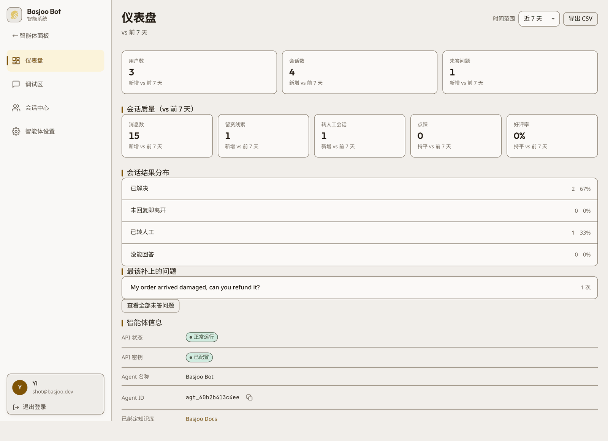

<p align="center"></p>

<h1 align="center">Basjoo</h1>

<p align="center">
<a href="https://www.docker.com/"></a>
<a href="https://fastapi.tiangolo.com/"></a>
<a href="https://vite.dev/"></a>
<a href="https://react.dev/"></a>
<a href="https://www.python.org/"></a>
<a href="https://www.typescriptlang.org/"></a>
<a href="https://www.sqlite.org/"></a>
<a href="https://qdrant.tech/"></a>
<a href="LICENSE"></a>
</p>

<p align="center"><a href="README.md">English</a> | 简体中文</p>

Basjoo 是一个可自托管的开源 AI 客服平台：把网站和一批文档变成一个可以嵌到任何页面的客服智能体，并配一套后台来运营它——数据看板、会话记录墙、人工接管、问答索引、留资线索，全都在你自己的一台机器上。

## 安装

```bash
curl -fsSL https://raw.githubusercontent.com/haoyiyin/basjoo/main/install-deploy.sh | sudo sh
```

全新的 **Ubuntu / Debian** 机器上一条命令搞定：缺 Docker 就装、拉代码、起 `prod` profile、等健康检查
通过、打印后台地址。注册的第一个账号就是工作区超级管理员。已经 clone 过？在仓库里跑
`sudo sh install-deploy.sh`。

**其他发行版也能用**——只要机器上已经有 Docker Engine（带 Compose 插件）、`git`、`python3`，脚本就跳过
装包直接部署；缺东西时会停下并明确告诉你装什么。想自己用 Compose 起？看下面的「手动 Docker Compose」。

- **FastAPI 后端**（`backend/`）——智能体、知识库、RAG 检索、SSE 流式聊天、定制问答、留资、数据看板、Webhook、认证、定时任务
- **Vite 单页后台**（`frontend-nextjs/`，目录名是上一代 Next.js 版本的遗留）
- **可嵌入聊天组件**（`widget/`）——一个 `<script>` 标签，通过 HTTP + SSE 与后端通信
- **检索栈**——Qdrant 存向量，SQLite 存业务数据，Redis 做限流，`basjoo-crawler` 抓取容器用无头浏览器渲染页面

整套服务跑在 Docker Compose 里。不依赖任何外部 SaaS：LLM 推理交给你配置的服务商，全新安装自带**本地
embedding 容器**，所以在没有任何 API 密钥之前知识库就能用。**不需要 GPU。**

## 功能

- **知识库是一等公民。** 知识库独立于智能体存在——创建、重置、删除、绑定都在知识库自己身上完成，一个知识库可以比用它的所有智能体活得都久。来源（URL、上传文件）属于知识库，不属于智能体。
- **每个知识库两条入库路径。** 抓单页、整站抓取（可设深度与页数上限），或上传文件（`txt`、`md`、`html`、`pdf`、`docx`、`xlsx`；单次最多 5 个文件、单文件 20 MB）。
- **每个知识库独立配置 Embedding。** `local`（自带 TEI 容器）、`jina`、`siliconflow`，或任意 `custom` OpenAI 兼容端点。创建知识库时会用一次真实 embedding 调用测出向量维度，集合与服务商不可能悄悄不匹配。
- **13 家 LLM 服务商**，同一份智能体配置里切换：OpenAI 兼容、OpenAI 原生、Anthropic、Google Gemini、xAI、DeepSeek、OpenRouter、z.ai、火山引擎、Moonshot、阿里百炼、腾讯云、硅基流动。
- **SSE 流式聊天**，带来源引用、首字保活、按访客限流，以及服务商异常时可配置的兜底回复。没配任何服务商密钥？把关键词整理成问答对，并把 `fallback_mode`（默认 `off`）设为 `keyword`：机器人就能在**不调用任何模型、不需要任何 API 密钥**的情况下回答命中的问题，回复标记为 `mode: "scripted"`；未命中则回落到受限回复。
- **每个知识库一套定制问答索引。** 问答对单独向量化、在任何检索段落之前先匹配，所以改一条答案不需要重建索引。支持批量导入、带分数与命中关键词的「试一句话」测试框、单条命中次数，以及在任意机器人回答上点一下「修正答案」直接把新问答对写回绑定的知识库。
- **可编辑的提示词分层。** 人设与模型在 AI 设置面板里，`fixed_facts` 存机器人绝不能违背的事实，流程按顺序编排多步指引——各自进入提示词的不同位置，不是重新训练模型。
- **能指出该补什么的看板。** 会话、消息、访客、留资、转人工、未答问题、点踩、好评率，覆盖 24 小时 / 7 天 / 30 天 / 90 天，每项都带与上一周期的对比和 CSV 导出。会话结束时自动归类（已解决、未回复即离开、已转人工、没能回答），未答队列按同一问题聚合，一键就能变成问答对。
- **留资。** `POST /api/v1/leads` 是公开路由（同样校验来源白名单），按会话写一条线索（幂等，刷新只是编辑同一条），带姓名、邮箱、电话、留言、页面地址和「已联系」标记；聊天请求里带 `prechat` 块也走同一套落库。线索在看板上计数，通过管理 API 列出——后台目前没有单独的线索页。
- **人工接管。** 运营在后台实时查看会话并接过去；组件侧轮询人工回复并完成交接。可以不接管直接回复、交还机器人、标记已解决，或重新打开已解决的会话。营业时间之外由机器人下班，离线文案会显示但**不会**写进会话记录。
- **不越界的组件。** 按智能体配置来源白名单，三种展示形态（悬浮气泡、内联容器、iframe），可排除路径，可设流量百分比（按访客决定一次，不会来回闪），入口卡片与开场提示，访客与会话存在 `localStorage`，文案随访客语言切换（中文 / 英文），90 秒流式超时并自动重试一次，还支持签名访客身份（`window.Basjoo.identify()`），给知道当前登录用户是谁的宿主站用。
- **对外 Webhook。** 七个事件（`session.created`、`session.closed`、`message.created`、`message.unanswered`、`handoff.requested`、`lead.created`、`document.indexed`），与业务变更写在同一事务里入队，用 `X-Basjoo-Signature: sha256=<hmac>` 对实际发送的字节签名，失败退避重试——接收方再慢也不会卡住一次回答。
- **中英双语后台**，暖色单强调色设计系统，375 px 宽度下布局不破。

## 界面截图

### 智能体

一张表看全部智能体：绑定的知识库、更新时间、状态与操作。


### 知识库

来源挂在知识库上：抓取设置、带抓取与索引状态的 URL 列表、上传文件与其解析出的分块数，以及排在检索之前的定制问答索引。


### 调试区

左边调服务商、模型与检索参数，右边直接对话——走的是和组件完全相同的流式链路。调试区**不配模型也能用**：未配置密钥的智能体由策划好的关键词路径接答，可以先测再配服务商。


### 会话中心

每个访客会话及完整对话记录，以及不该由机器人单独完成的动作：回复、接管、交还、标记已解决、重新打开、发送邮件记录、删除该访客的数据。


### 数据看板

八项指标都带与上一周期的对比，外加已完成会话的结果分布，以及没答上来的问题——每一行都能点回产生它的那条消息。



### 智能体设置与嵌入代码

按提示词顺序分五组——AI 本身、给它的材料、人工接管、放到网站上、告诉其他系统（Webhook），含展示形态、
入口卡片、开场提示，以及要粘到自己站点的嵌入代码。


### 嵌入式组件


## 快速开始

### 手动 Docker Compose

```bash
git clone https://github.com/haoyiyin/basjoo.git
cd basjoo
cp .env.example .env        # 可选：所有配置都有可用默认值

docker compose --profile prod up -d     # nginx 监听 :80（./ssl 里有证书时同时开 :443）
# 或者带热重载的开发环境：
docker compose --profile dev up --watch # 前端 :3000，后端 :8000
```

然后打开后台注册第一个管理员：

- prod：`http://localhost/`
- dev：`http://localhost:3000/`

到 **调试区 → AI 设置** 填一个服务商密钥（或给默认智能体设 `DEEPSEEK_API_KEY`），自带的示例智能体就能对话了——或者干脆先不填密钥，整理几条关键词问答对，直接体验脚本化关键词路径。

### 默认端口

| 服务 | dev | prod |
|---|---|---|
| 管理后台 | `localhost:3000` | `localhost:80`（nginx） |
| 后端 API | `localhost:8000` | 经 nginx |
| Qdrant | `127.0.0.1:6333` | 仅容器网络 |
| Redis | `127.0.0.1:6379` | 仅容器网络 |

## 系统要求

LLM 推理始终是外部 API 调用。Embedding 也可以走外部，但默认栈会跑自带的 `local-embed` 容器（纯 CPU，常驻约
1.2 GB）。抓取容器用无头 Chromium 渲染页面：首次抓取后常驻约 380 MB，8 个页面并发时约 425 MB（浏览器进程
全局共享，并发几乎不额外占内存），镜像约 2.1 GB。

| | 最低配置 | 推荐配置 |
|---|---|---|
| CPU | 2 vCPU | 2–4 vCPU |
| 内存 | 4 GB | 8 GB |
| 磁盘 | 25 GB | 50 GB |
| 操作系统 | Ubuntu 22.04+ / Debian 11+ | Ubuntu 22.04+ / Debian 12+ |
| Docker | 20.10+ 且带 Compose 插件 | 最新版 |

这些数字是在我们的参考机器上量的，代码里没有任何地方强制：`install-deploy.sh` 只检查发行版是不是 Ubuntu /
Debian 系，compose 也没给任何服务设内存上限。内存下限已包含嵌入容器。它的模型（`ibm-granite/granite-embedding-97m-multilingual-r2`，约 400 MB）首次
启动时下载一次并存入 `local-embed-cache` 卷；下载期间服务照常可用，示例智能体会在下次登录时创建。想改用
托管 Embedding API，就用 `jina` / `siliconflow` / `custom` 新建知识库，并停掉 `local-embed`。

## 工作原理

```
浏览器 ──▶ 组件 / 管理后台
             │  HTTP + SSE
             ▼
        nginx（prod）──▶ FastAPI 后端 ──▶ Qdrant        （向量，每个知识库一个集合）
                              │      └──▶ SQLite        （智能体、知识库、文档、会话、线索）
                              ├────────▶ Redis         （限流）
                              ├────────▶ basjoo-crawler （crawl4ai，无头 Chromium）
                              ├────────▶ local-embed   （TEI，CPU embedding）
                              └────────▶ LLM 服务商    （OpenAI 兼容 HTTP）
```

### 知识库

`KnowledgeBase → KbDocument → KbChunk`，按工作区隔离。每个知识库一个 Qdrant 集合（`kb_<12 位十六进制>`，
余弦距离），检索时带 `kb_id` payload 过滤。切块默认 512 / 64，embedding 每批不超过 100 条；检索先取 `top_k × 2` 个候选
再按分数过滤。生效的相似度阈值依次是：请求参数 → 智能体的 `similarity_threshold` → 服务默认值。

绑定是智能体与知识库之间唯一的联系：`PUT /api/v1/agents/{agent_id}/knowledge-base`。因为 `agents.kb_id`
是 `UNIQUE`，一个知识库最多被一个智能体使用；删除智能体只会清掉这个指针，知识库、文档、分块和 URL 来源都保留。

### 聊天

`POST /api/v1/chat/stream` 刻意分两段：先是短数据库阶段（解析智能体 → 来源白名单 → 会话 → 限流 →
读取历史 → 匹配定制问答 → 检索上下文），随后是**不持有数据库连接**的流式阶段。事件名只有 `sources`、
`content`、`thinking_done`、`done`、`error`。没配服务商密钥会明确返回 `400 API_KEY_MISSING`，绝不用 mock
蒙过去——除非智能体选择了脚本化关键词路径（`fallback_mode="keyword"`）：此时未配密钥的智能体用无模型调用的方式
回答命中的问题，未命中则回落到受限回复。
会话 ID 可枚举，所以公开接口要求调用方带自己的 `visitor_id`，别人的会话一律 `404 Session not found`。

机器人是否开口只由一道闸门决定：`services/session_state.answer_gate` 要求 `status="active"`、
`mode="ai"`，**并且**智能体当前处于营业时间内。其余情况仍会把访客消息存库、但一句都不回，并通过
`done.no_answer_reason` 说明原因（`taken_over`、`resolved`、`closed`、`paused`、`human` 或 `after_hours`）。
`after_hours` 是唯一保持 `mode` 为 `ai` 的情况，同时把运营配置的 `away_message` 作为可见回复下发——
它**不会**写进会话记录，避免历史记录假装是人写的。没配营业时间（或配置无法解析）的智能体永远在线。

每条机器人回复都带一个 `confidence`：构造提示词时用到的最佳检索分数，什么都没检索到时为 `null`。没有命中任何
段落、或内容等于兜底话术的回答会被标记 `is_unanswered`——看板的未答队列和「加入问答」按钮读的就是这个标记。

### 组件

`widget/src/BasjooWidget.tsx` 从 `<script src="…/sdk.js?agent_id=agt_…">` 自举（也接受 `agentId` 和
`api_base`），从自身脚本地址推断 API 基址，请求 `/api/v1/config:public` 拿标题、颜色、欢迎语与安装选项，把访客和会话
存在 `localStorage`，从 `/api/v1/chat/stream` 流式接收回复，并在首条回复落地后开始每 3 秒轮询
`/api/v1/chat/messages`（带访客 id 与 `after_id`，只要 assistant 角色）——人工接管的消息就是这样到达的。

```html
<script src="https://your-basjoo-host/sdk.js?agent_id=agt_xxxxxxxxxxxx" async></script>
```

后台下发的其实是 `/api/v1/agents/{id}/embed.js`，它把单个智能体的安装配置（展示形态、排除路径、流量百分比、
入口卡片、开场提示）烤进一个专属 loader。已经知道当前访客是谁的宿主站，可以带着服务端签发的 HMAC 调用
`window.Basjoo.identify({ email, hash })`，组件就会用这个签名身份代替随机身份。

## 配置

配置来自环境变量或 `.env`（`pydantic-settings`）。下表每一项都有可用默认值；`docker-compose.yml` 只覆盖
`dev` 与 `prod` 两个 profile 之间不同的那几项。

| 变量 | 默认值 | 用途 |
|---|---|---|
| `DATABASE_URL` | `sqlite:///./data/basjoo.db` | 业务数据（只有 SQLite，没有 PostgreSQL 分支） |
| `REDIS_URL` | `redis://redis:6379/0` | 限流 |
| `QDRANT_URL` | `http://localhost:6333` | 向量库 |
| `QDRANT_API_KEY` | 未设置 | 需要鉴权的 Qdrant 所用密钥 |
| `SCRAPLING_SERVICE_URL` | `http://scrapling-service:8001` | 网页入库调用的抓取服务 |
| `SECRET_KEY` / `SECRET_KEY_FILE` | 自动生成 → `/app/data/.secret_key` | JWT 签名 |
| `ENCRYPTION_KEY` / `ENCRYPTION_KEY_FILE` | 自动生成 → `/app/data/.encryption_key` | 加密存储服务商密钥、Webhook 密钥与身份密钥 |
| `DEFAULT_AGENT_ID` | 自动生成 → `/app/data/.agent_id` | 固定默认组件智能体身份 |
| `PUBLIC_BASE_URL` | 未设置 | 拼嵌入代码与 `/config:public` 用的公网地址；不设则依次信任 `X-Forwarded-Host`、`Host` |
| `ALLOWED_ORIGINS` | 代码里 `*`，dev 为 `*`，prod 为空 | CORS 白名单；空表示不允许跨域调用 |
| `CORS_ALLOW_NULL_ORIGIN` | `false` | 接受 `Origin: null` 的沙箱 iframe |
| `TRUSTED_PROXY_IPS` | 空；compose 里为 `172.16.0.0/12` | 可信任 `X-Forwarded-For` / `X-Real-IP` 的对端；为空时所有限流按 socket 对端计数 |
| `SSRF_PROTECTION_ENABLED` | `false` | 拦截用户所填 URL 解析到内网/链路本地地址 |
| `LOCAL_EMBEDDING_BASE_URL` | `http://local-embed:80/v1` | `local` 知识库使用的端点 |
| `LOCAL_EMBEDDING_MODEL` | `ibm-granite/granite-embedding-97m-multilingual-r2` | 该端点上的模型 |
| `RATE_LIMIT_PER_MINUTE` / `RATE_LIMIT_BURST_SIZE` | `1000` / `200` | 全局限流 |
| `LOGIN_RATE_LIMIT_MAX_ATTEMPTS` / `LOGIN_RATE_LIMIT_WINDOW_SECONDS` | `5` / `300` | 登录失败限流，按 IP 与按账号各计一份 |
| `SMTP_HOST` / `SMTP_PORT` / `SMTP_USER` / `SMTP_PASSWORD` / `SMTP_FROM` / `SMTP_USE_TLS` | 空 / `587` / … / `true` | 会话记录邮件；主机为空时该路由返回 `503`，不是发送失败 |
| `REQUIRE_SECRET_KEY` | 未设置；`prod` compose 里为 `true` | 设为 `true` 时拒绝用自动生成的密钥启动（由容器入口脚本检查，不由应用检查） |
| `SERVER_DOMAIN` | 未设置 | nginx 规范域名，其他 Host 直接 `444` |
| `LOG_LEVEL` | `INFO` | |
| `DEBIAN_MIRROR` | `http://deb.debian.org` | 后端与抓取镜像构建时的 apt 源；代理会破坏默认源时改它 |

`SSRF_PROTECTION_ENABLED` 默认关闭：fake-ip / 分离解析的 DNS（sing-box、clash）会把普通公网站点解析进私有
网段，开着会拒绝所有真实抓取。协议、内嵌凭据、空主机名、`localhost`、直接 IP 字面量这几种检查始终生效；
抓取服务遵循同一个开关。

`DEFAULT_AGENT_ID` 只固定 id，不会重建被删掉的智能体记录。要么恢复数据卷，要么用
`CREATE_DEFAULT_AGENT_ON_BOOTSTRAP=true` 启动一次。

## 开发

```bash
# 后端
cd backend && python3 -m venv venv && source venv/bin/activate
pip install -r requirements.txt && python3 main.py        # :8000，/health

# 管理后台
cd frontend-nextjs && npm install && npm run dev          # :3000，/api 代理到 :8000

# 组件
cd widget && npm install && npm run dev                   # 打包 + 示例宿主页
```

提交前必跑：

```bash
cd frontend-nextjs && npm run build && npm run typecheck && npm run test   # vitest
cd widget && npm run build && npm run test
cd backend && pytest
npm run sync-widget        # 重新打包组件并复制到 backend/static/sdk.js
npm run test:e2e           # 针对 dev profile 的 Playwright smoke
```

`npm run sync-widget` 不能省：`widget/dist/basjoo-widget.min.js` 与 `backend/static/sdk.js` 必须逐字节一致，
`sdk.js` 永远不要手改。

## API 概览

后台使用 `/api/admin`（登录、注册、账号、用户）与 `/api/v1`。最常用的路由：

- `GET /health`、`GET /api/v1/config:public`、`GET /api/v1/agents/{id}/embed.js`
- `GET|POST /api/v1/agents`、`POST /api/v1/agents/{id}:pause|:resume`、`DELETE /api/v1/agents/{id}`
- `GET|PUT /api/v1/agent`、`GET /api/v1/agent:kb-status`
- `GET|POST /api/v1/knowledge-bases`、`GET|PATCH|DELETE /api/v1/knowledge-bases/{kb_id}`、
  `POST /api/v1/knowledge-bases/{kb_id}/reset`
- `PUT /api/v1/agents/{agent_id}/knowledge-base` —— 绑定知识库的唯一入口
- `POST /api/v1/knowledge-bases/{kb_id}/urls:create|:refetch|:discover|:crawl_site|:cancel`、
  `…/files:upload`、`…/index:rebuild`
- `GET /api/v1/knowledge-bases/{kb_id}/sources:summary`、`…/index:status`
- `GET|POST /api/v1/knowledge-bases/{kb_id}/qa-items`、`PUT|DELETE …/qa-items/{qa_id}`、
  `POST …/qa-items:match`、`POST …/qa-items:import`
- `GET|POST|PUT|DELETE /api/v1/agents/{agent_id}/procedures`、`PUT /api/v1/agents/{agent_id}/fixed-facts`
- `POST /api/v1/chat/stream`、`GET /api/v1/chat/messages`、`POST /api/v1/chat/escalate|release|feedback`
- `POST /api/v1/leads`、`GET /api/v1/admin/leads`、`PATCH|GET /api/v1/admin/leads/{id}`
- `GET /api/v1/admin/analytics`、`GET /api/v1/admin/stats/overview`、`GET /api/v1/admin/stats/export.csv`
- `GET /api/v1/admin/sessions`、`POST /api/v1/admin/sessions/send`
- `POST /api/v1/admin/sessions/{id}/takeover|release|reply|resolve|reopen|email-transcript`
- `GET /api/v1/admin/sessions/unanswered`、`POST …/unanswered/{message_id}:dismiss`、
  `POST /api/v1/admin/sessions/{id}/revise-answer`、`POST /api/v1/admin/qa/from-message/{message_id}`
- `DELETE /api/v1/admin/visitors/{visitor_id}` —— 删除某个访客的会话、消息、线索与反馈

智能体维度的 `/api/v1/urls:*`、`/api/v1/files:*`、`/api/v1/index:*` 仍然能用，但都是保留一版的别名：它们
通过 `agents.kb_id` 反查知识库，未绑定时返回 `409`。新接入请直接用知识库维度的路径。完整 schema 在
`/openapi.json`。

## 部署说明

- Ubuntu/Debian 上走 `install-deploy.sh`，它内部调用 `deploy.sh`。`docker-compose.yml` 是唯一的 Compose
  入口，分 `dev` / `prod` 两个 profile，并固定了项目名，所以第二个 checkout 不会造出第二套空数据卷。
- `nginx` 在容器内监听 `:8080`（映射到宿主机 `:80`），只有当 `./ssl` 下存在可读的 `cert.pem` / `key.pem`
  时才开 `:443`。生成的 vhost 里 `client_max_body_size` 为 12 MB（既没设 `SERVER_DOMAIN` 也没证书时用镜像
  自带的兜底配置，是 50 MB），超限请求因此拿到 JSON 报错而不是 nginx 的 HTML 页。
- 持久化卷：`backend-data` → `/app/data`（SQLite 数据库、密钥文件、上传的知识库文件）、`qdrant-data`、
  `redis-data`、`local-embed-cache`。`docker compose down -v` 会把四个都删掉。
- 只要 `backend-data` 还在，旧嵌入代码就继续有效：智能体 id 落在 `/app/data/.agent_id`，迁移机器时用
  `DEFAULT_AGENT_ID` 固定已知 id。搬之前至少备份 `/app/data/basjoo.db` 和 `/app/data/.agent_id`。
- 后台访问地址与访客访问地址不同时，设 `PUBLIC_BASE_URL`；否则嵌入代码会回落到请求自身的 `Host`。
- 新增第二个管理员要走超管 token（`POST /api/admin/users`）；自助注册只对第一个管理员开放，后台目前没有
  用户管理界面。

## 已知限制

- 单机设计：SQLite、单后端进程、进程内调度器。没有 Postgres / pgvector 分支可切。
- 一个知识库只能绑一个智能体（`agents.kb_id` 唯一），知识库不在智能体之间共享。
- 角色（`super_admin`、`admin`、`support`）由 API 强制，后台暴露的是账号设置与智能体成员，不是完整的
  管理员增删改查。
- 文档解析支持 `txt`、`md`、`html`、`pdf`、`docx`、`xlsx`；扫描版 PDF 没有 OCR。
- 工作区配额限制的是智能体数量、定制问答条数、文本总量；URL 与文件计数报的 500 上限服务端并不强制，消息量只按访客每分钟限流，没有每日总额。
- Webhook 是尽力而为：入队并退避重试，但长期失败的接收方只会出现在后端日志里，后台没有告警。
- 会话记录邮件需要配好 SMTP；没配时该路由返回 `503`，按钮会把原因显示出来。
- `Agent.last_error_code` / `last_error_message` / `last_error_at` 三个字段目前没有任何写入方，后台也没有
  消费方；服务商失败只会体现为兜底回复和后端日志，不会在控制台弹告警。

## 仓库结构

| 路径 | 内容 |
|---|---|
| `backend/` | FastAPI 应用：`api/` 路由、`services/` 逻辑、`models.py`、`tests/` |
| `frontend-nextjs/` | Vite 单页后台（`src/views`、`src/components`、`src/index.css` 设计令牌） |
| `widget/` | 可嵌入组件源码、esbuild 产物、示例宿主页 |
| `scrapling-service/` | 抓取微服务（crawl4ai + `curl_cffi`/readability 兜底），容器名 `basjoo-crawler` |
| `nginx/` | `prod` profile 使用的反向代理 |
| `tests/e2e/` | Playwright 用例（smoke、prod-like、组件跨域） |
| `scripts/` | `sync-widget.sh`、`prod_stability_check.sh` |
| `resource/screenshots/` | 这两份 README 用到的图片 |

`AGENTS.md` 详细记录了架构契约（知识库作用域、SSE watchdog、设计令牌），改动这些区域的代码前先读它。

## 许可证

[MIT](LICENSE)。

## 致谢

- **[Qdrant](https://qdrant.tech/)** —— 每个知识库独立集合背后的向量检索。
- **[crawl4ai](https://github.com/unclecode/crawl4ai)** —— 抓取服务里的无头渲染。
- **[Scrapling](https://github.com/D4Vinci/Scrapling)** —— `scrapling-service/` 里保留的 `curl_cffi` /
  readability 兜底提取。
- **[Text Embeddings Inference](https://github.com/huggingface/text-embeddings-inference)** —— 自带的 CPU
  embedding 服务。
- **[FastAPI](https://fastapi.tiangolo.com/)** 与 **[Vite](https://vite.dev/)** —— 后端与后台工具链。

## Star 趋势

[](https://star-history.com/#haoyiyin/basjoo&Date)
