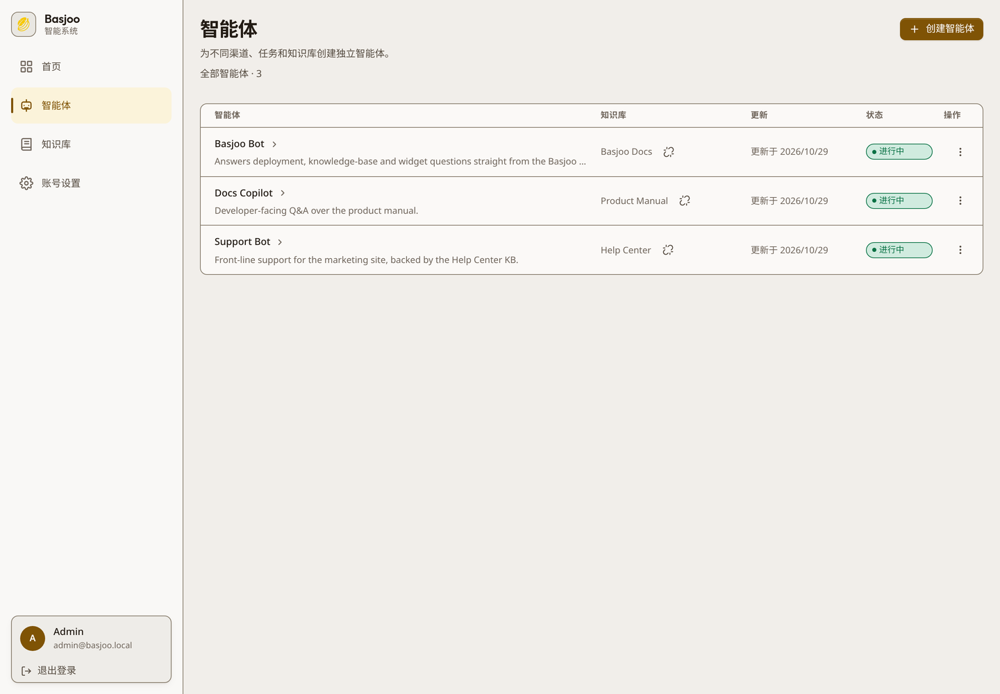
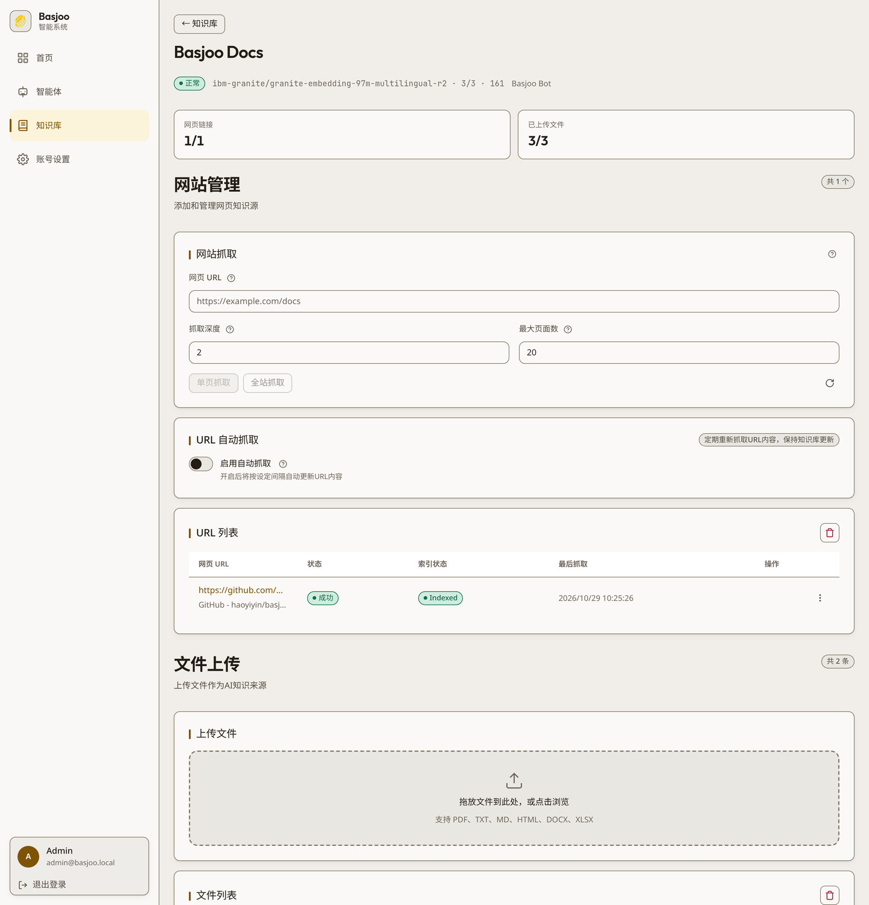
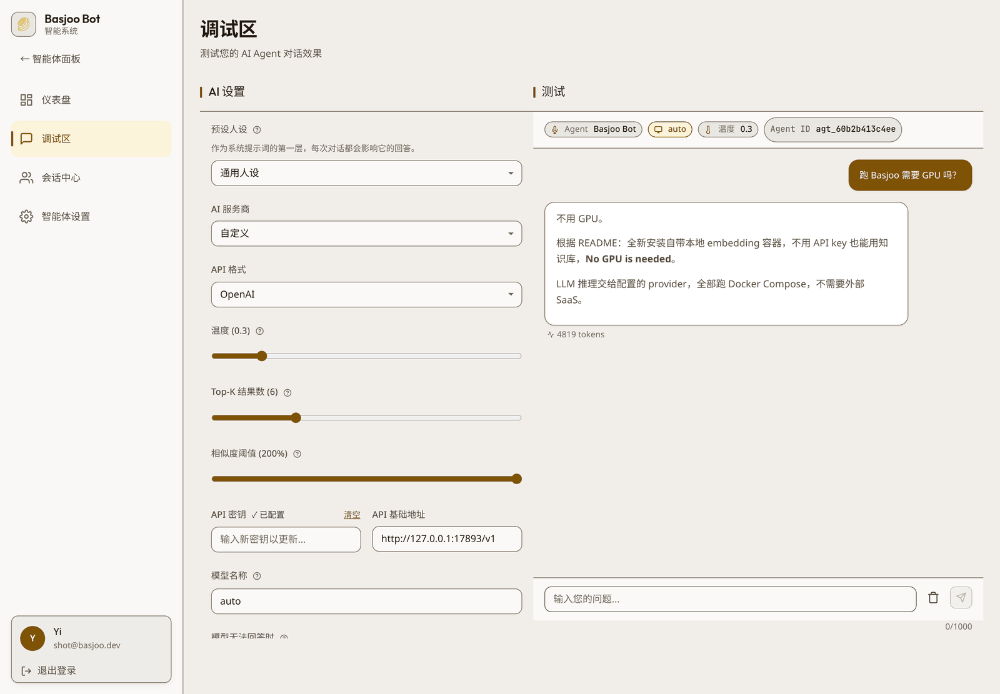
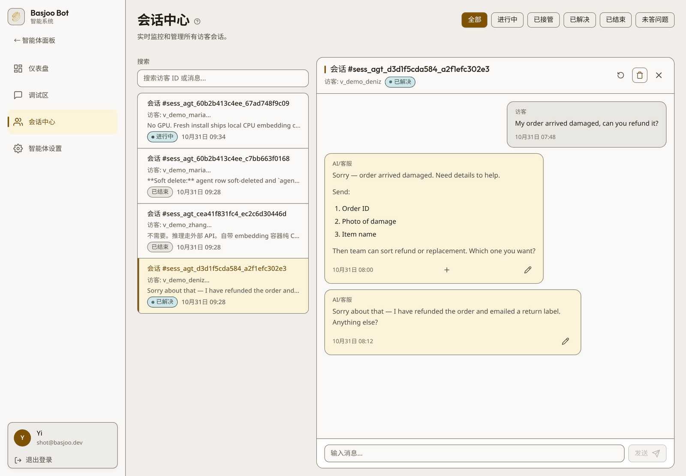
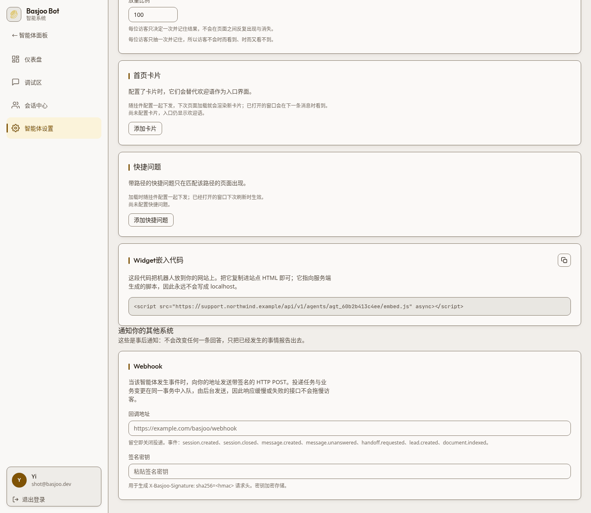
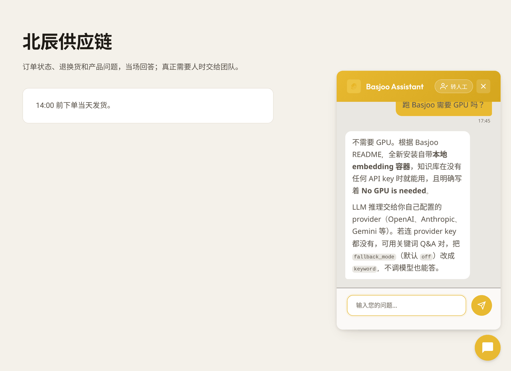

# Basjoo

[](https://www.docker.com/)
[](https://fastapi.tiangolo.com/)
[](https://vite.dev/)
[](https://react.dev/)
[](https://www.python.org/)
[](https://www.typescriptlang.org/)
[](https://www.sqlite.org/)
[](https://qdrant.tech/)
[](LICENSE)

[English](README.md) | 简体中文

Basjoo 是一个可自托管的开源 AI 客服平台：把网站和一批文档变成一个可以嵌到任何页面的客服智能体，并配一套管理后台来运营它。

- **FastAPI 后端**（`backend/`）——智能体、知识库、RAG 检索、SSE 流式聊天、认证、配额、定时任务
- **Vite 单页管理后台**（`frontend-nextjs/`，目录名是上一代 Next.js 版本的遗留）
- **可嵌入聊天组件**（`widget/`）——一个 `<script>` 标签，通过 HTTP + SSE 与后端通信
- **检索栈**——Qdrant 存向量，SQLite 存业务数据，Redis 做限流，`basjoo-crawler` 抓取容器用无头浏览器渲染页面

整套服务跑在 Docker Compose 里。不依赖任何外部 SaaS：LLM 推理交给你配置的服务商，全新安装自带**本地
embedding 容器**，所以在没有任何 API 密钥之前知识库就能用。**不需要 GPU。**

## 功能

- **知识库是一等公民。** 知识库独立于智能体存在——创建、重置、删除、绑定都在知识库自己身上完成，一个知识库可以比用它的所有智能体活得都久。来源（URL、上传文件）属于知识库，不属于智能体。
- **每个知识库两条入库路径。** 抓单页、整站抓取（可设深度与页数上限），或上传文件（`txt`、`md`、`html`、`pdf`、`docx`、`xlsx`；单次最多 5 个文件、单文件 20 MB）。可选自动重抓，让网页来源按周期保持最新。
- **每个知识库独立配置 Embedding。** `local`（自带 TEI 容器）、`jina`、`siliconflow`，或任意 `custom` OpenAI 兼容端点。创建知识库时会用一次真实 embedding 调用测出向量维度，集合与服务商不可能悄悄不匹配。
- **13 家 LLM 服务商**，同一份智能体配置里切换：OpenAI 兼容、OpenAI 原生、Anthropic、Google Gemini、xAI、DeepSeek、OpenRouter、z.ai、火山引擎、Moonshot、阿里百炼、腾讯云、硅基流动。
- **SSE 流式聊天**，带来源引用、首字保活、按访客限流，以及服务商异常时可配置的兜底回复。
- **人工接管。** 运营在后台实时查看会话并接过去；组件侧轮询人工回复并完成交接。
- **不越界的组件。** 按智能体配置来源白名单，访客与会话存在 `localStorage`，文案随访客语言切换（中文 / 英文），90 秒流式超时并自动重试一次。
- **中英双语后台**，暖色单强调色设计系统，375 px 宽度下布局不破。

## 界面截图

### 智能体

一张表看全部智能体：绑定的知识库、更新时间、状态与操作。



### 知识库

来源挂在知识库上：抓取设置、带抓取与索引状态的 URL 列表、以及上传文件与其解析出的分块数。



### 调试区

左边调服务商、模型与检索参数，右边直接对话——走的是和组件完全相同的流式链路。



### 会话中心与人工接管

每个访客会话及完整对话记录，不该由机器人单独收尾的会话可以一键接管。



### 智能体设置与嵌入代码

组件标题、颜色、欢迎语、历史保留天数、来源白名单、每分钟限额——以及要粘到自己站点的嵌入代码。



### 嵌入式组件



## 快速开始

### 一键安装（Ubuntu / Debian）

```bash
curl -fsSL https://raw.githubusercontent.com/haoyiyin/basjoo/main/install-deploy.sh | sudo sh
```

脚本会自动装 Docker（缺失时）、拉仓库、启动 **prod** profile、等待健康检查通过，并打印后台地址。已经
检出仓库的话，直接 `sudo sh install-deploy.sh` 即可。

第一个注册的账号成为该工作区的超级管理员。

### 手动 Docker Compose

```bash
git clone https://github.com/haoyiyin/basjoo.git
cd basjoo
cp .env.example .env        # 可选：所有配置都有可用默认值

docker compose --profile prod up -d     # nginx 监听 :80（./ssl 里有证书时同时开 :443）
# 或者带热重载的开发环境：
docker compose --profile dev up --watch # 前端 :3000，后端 :8000
```

然后打开后台注册第一个管理员：

- prod：`http://localhost/`
- dev：`http://localhost:3000/`

到 **调试区 → AI 设置** 填一个服务商密钥（或给默认智能体设 `DEEPSEEK_API_KEY`），自带的示例智能体就能对话了。

### 默认端口

| 服务 | dev | prod |
|---|---|---|
| 管理后台 | `localhost:3000` | `localhost:80`（nginx） |
| 后端 API | `localhost:8000` | 经 nginx |
| Qdrant | `127.0.0.1:6333` | 仅容器网络 |
| Redis | `127.0.0.1:6379` | 仅容器网络 |

## 系统要求

LLM 推理始终是外部 API 调用。Embedding 也可以走外部，但默认栈会跑自带的 `local-embed` 容器（纯 CPU，常驻约
1.2 GB）。抓取容器用无头 Chromium 渲染页面：首次抓取后常驻约 380 MB，8 个页面并发时约 425 MB（浏览器进程
全局共享，并发几乎不额外占内存），镜像约 2.1 GB。

| | 最低配置 | 推荐配置 |
|---|---|---|
| CPU | 2 vCPU | 2–4 vCPU |
| 内存 | 4 GB | 8 GB |
| 磁盘 | 25 GB | 50 GB |
| 操作系统 | Ubuntu 22.04+ / Debian 11+ | Ubuntu 22.04+ / Debian 12+ |
| Docker | 20.10+ 且带 Compose 插件 | 最新版 |

这些数字是在我们的参考机器上量的，代码里没有任何地方强制：`install-deploy.sh` 只检查发行版是不是 Ubuntu /
Debian 系，compose 也没给任何服务设内存上限。内存下限已包含嵌入容器。它的模型（`ibm-granite/granite-embedding-97m-multilingual-r2`，约 400 MB）首次
启动时下载一次并存入 `local-embed-cache` 卷；下载期间服务照常可用，示例智能体会在下次登录时创建。想改用
托管 Embedding API，就用 `jina` / `siliconflow` / `custom` 新建知识库，并停掉 `local-embed`。

## 工作原理

```
浏览器 ──▶ 组件 / 管理后台
             │  HTTP + SSE
             ▼
        nginx（prod）──▶ FastAPI 后端 ──▶ Qdrant        （向量，每个知识库一个集合）
                              │      └──▶ SQLite        （智能体、知识库、文档、会话）
                              ├────────▶ Redis         （限流）
                              ├────────▶ basjoo-crawler （crawl4ai，无头 Chromium）
                              ├────────▶ local-embed   （TEI，CPU embedding）
                              └────────▶ LLM 服务商    （OpenAI 兼容 HTTP）
```

### 知识库

`KnowledgeBase → KbDocument → KbChunk`，按工作区隔离。每个知识库一个 Qdrant 集合（`kb_<12 位十六进制>`，
余弦距离），检索时带 `kb_id` payload 过滤。切块默认 512 / 64，embedding 每批不超过 100 条；检索先取 `top_k × 2` 个候选
再按分数过滤。生效的相似度阈值依次是：请求参数 → 智能体的 `similarity_threshold` → 服务默认值。

绑定是智能体与知识库之间唯一的联系：`PUT /api/v1/agents/{agent_id}/knowledge-base`。因为 `agents.kb_id`
是 `UNIQUE`，一个知识库最多被一个智能体使用；删除智能体只会清掉这个指针，知识库、文档、分块和 URL 来源都保留。

### 聊天

`POST /api/v1/chat/stream` 刻意分两段：先是短数据库阶段（解析智能体 → 来源白名单 → 配额 → 会话 → 限流 →
读取历史 → 检索上下文），随后是**不持有数据库连接**的流式阶段。事件名只有 `sources`、`content`、
`thinking_done`、`done`、`error`。没配服务商密钥会明确返回 `400 API_KEY_MISSING`，绝不用 mock 蒙过去。
会话 ID 可枚举，所以公开接口要求调用方带自己的 `visitor_id`，别人的会话一律 `404 Session not found`。

### 组件

`widget/src/BasjooWidget.tsx` 从 `<script src="…/sdk.js?agent_id=agt_…">` 自举（也接受 `agentId` 和
`api_base`），从自身脚本地址推断 API 基址，请求 `/api/v1/config:public` 拿标题、颜色与欢迎语，把访客和会话
存在 `localStorage`，从 `/api/v1/chat/stream` 流式接收回复，并在首条回复落地后开始每 3 秒轮询
`/api/v1/chat/messages`（带访客 id 与 `after_id`，只要 assistant 角色）——人工接管的消息就是这样到达的。

```html
<script src="https://your-basjoo-host/sdk.js?agent_id=agt_xxxxxxxxxxxx" async></script>
```

## 配置

配置来自环境变量或 `.env`（`pydantic-settings`）。下表中每一项都有可用默认值。

| 变量 | 默认值 | 用途 |
|---|---|---|
| `DATABASE_URL` | `sqlite:///./data/basjoo.db` | 业务数据（只有 SQLite，没有 PostgreSQL 分支） |
| `REDIS_URL` | `redis://redis:6379/0` | 限流 |
| `QDRANT_URL` | `http://localhost:6333` | 向量库 |
| `QDRANT_API_KEY` | 未设置 | 需要鉴权的 Qdrant 所用密钥 |
| `SCRAPLING_SERVICE_URL` | `http://scrapling-service:8001` | 网页入库调用的抓取服务 |
| `SECRET_KEY` / `SECRET_KEY_FILE` | 自动生成 → `/app/data/.secret_key` | JWT 签名 |
| `ENCRYPTION_KEY` / `ENCRYPTION_KEY_FILE` | 自动生成 → `/app/data/.encryption_key` | 加密存储服务商密钥 |
| `DEFAULT_AGENT_ID` | 自动生成 → `/app/data/.agent_id` | 固定默认组件智能体身份 |
| `ALLOWED_ORIGINS` | 空（dev profile 设为 `*`） | CORS 白名单；空表示不允许跨域调用 |
| `SSRF_PROTECTION_ENABLED` | `false` | 拦截用户所填 URL 解析到内网/链路本地地址 |
| `LOCAL_EMBEDDING_BASE_URL` | `http://local-embed:80/v1` | `local` 知识库使用的端点 |
| `LOCAL_EMBEDDING_MODEL` | `ibm-granite/granite-embedding-97m-multilingual-r2` | 该端点上的模型 |
| `RATE_LIMIT_PER_MINUTE` / `RATE_LIMIT_BURST_SIZE` | `1000` / `200` | 全局限流 |
| `REQUIRE_SECRET_KEY` | 未设置 | 设为 `true` 时拒绝用自动生成的密钥启动（由容器入口脚本检查，不由应用检查） |
| `SERVER_DOMAIN` | 未设置 | nginx 规范域名，其他 Host 直接 `444` |
| `CORS_ALLOW_NULL_ORIGIN` | `false` | 接受 `Origin: null` 的沙箱 iframe |
| `LOG_LEVEL` | `INFO` | |

`SSRF_PROTECTION_ENABLED` 默认关闭：fake-ip / 分离解析的 DNS（sing-box、clash）会把普通公网站点解析进私有
网段，开着会拒绝所有真实抓取。协议、内嵌凭据、空主机名、`localhost`、直接 IP 字面量这几种检查始终生效；
抓取服务遵循同一个开关。

`DEFAULT_AGENT_ID` 只固定 id，不会重建被删掉的智能体记录。要么恢复数据卷，要么用
`CREATE_DEFAULT_AGENT_ON_BOOTSTRAP=true` 启动一次。

## 开发

```bash
# 后端
cd backend && python3 -m venv venv && source venv/bin/activate
pip install -r requirements.txt && python3 main.py        # :8000，/health

# 管理后台
cd frontend-nextjs && npm install && npm run dev          # :3000，/api 代理到 :8000

# 组件
cd widget && npm install && npm run dev                   # 打包 + 示例宿主页
```

提交前必跑：

```bash
cd frontend-nextjs && npm run build && npm run typecheck && npm run test   # vitest
cd widget && npm run build && npm run test
cd backend && pytest
npm run sync-widget        # 重新打包组件并复制到 backend/static/sdk.js
npm run test:e2e           # 针对 dev profile 的 Playwright smoke
```

`npm run sync-widget` 不能省：`widget/dist/basjoo-widget.min.js` 与 `backend/static/sdk.js` 必须逐字节一致，
`sdk.js` 永远不要手改。

## API 概览

后台使用 `/api/admin`（登录、注册、账号、用户）与 `/api/v1`。最常用的路由：

- `GET /health`、`GET /api/v1/config:public`
- `GET|POST /api/v1/agents`、`POST /api/v1/agents/{id}:pause|:resume`、`DELETE /api/v1/agents/{id}`
- `GET|PUT /api/v1/agent`、`GET /api/v1/agent:kb-status`
- `GET|POST /api/v1/knowledge-bases`、`GET|PATCH|DELETE /api/v1/knowledge-bases/{kb_id}`
- `PUT /api/v1/agents/{agent_id}/knowledge-base` —— 绑定知识库的唯一入口
- `POST /api/v1/knowledge-bases/{kb_id}/urls:create|:refetch|:discover|:crawl_site|:cancel`
- `POST /api/v1/knowledge-bases/{kb_id}/files:upload`、`POST …/index:rebuild`
- `GET /api/v1/knowledge-bases/{kb_id}/sources:summary`、`…/index:status`
- `POST /api/v1/chat/stream`、`GET /api/v1/chat/messages`
- `GET /api/v1/admin/sessions`、`POST /api/v1/admin/sessions/{id}/takeover`、`POST /api/v1/admin/sessions/send`

智能体维度的 `/api/v1/urls:*`、`/api/v1/files:*`、`/api/v1/index:*` 仍然能用，但都是保留一版的别名：它们
通过 `agents.kb_id` 反查知识库，未绑定时返回 `409`。新接入请直接用知识库维度的路径。完整 schema 在
`/openapi.json`。

## 部署说明

- Ubuntu/Debian 上走 `install-deploy.sh`，它内部调用 `deploy.sh`。`docker-compose.yml` 是唯一的 Compose
  入口，分 `dev` / `prod` 两个 profile，并固定了项目名，所以第二个 checkout 不会造出第二套空数据卷。
- `nginx` 在容器内监听 `:8080`（映射到宿主机 `:80`），只有当 `./ssl` 下存在可读的 `cert.pem` / `key.pem`
  时才开 `:443`。生成的 vhost 里 `client_max_body_size` 为 12 MB（既没设 `SERVER_DOMAIN` 也没证书时用镜像
  自带的兜底配置，是 50 MB），超限请求因此拿到 JSON 报错而不是 nginx 的 HTML 页。
- 持久化卷：`backend-data` → `/app/data`（SQLite 数据库、密钥文件、上传的知识库文件）、`qdrant-data`、
  `redis-data`、`local-embed-cache`。`docker compose down -v` 会把四个都删掉。
- 只要 `backend-data` 还在，旧嵌入代码就继续有效：智能体 id 落在 `/app/data/.agent_id`，迁移机器时用
  `DEFAULT_AGENT_ID` 固定已知 id。搬之前至少备份 `/app/data/basjoo.db` 和 `/app/data/.agent_id`。
- 新增第二个管理员要走超管 token（`POST /api/admin/users`）；自助注册只对第一个管理员开放，后台目前没有
  用户管理界面。

## 已知限制

- 单机设计：SQLite、单后端进程、进程内调度器。没有 Postgres / pgvector 分支可切。
- 一个知识库只能绑一个智能体（`agents.kb_id` 唯一），知识库不在智能体之间共享。
- 角色（`super_admin`、`admin`、`support`）由 API 强制，后台暴露的是账号设置与智能体成员，不是完整的
  管理员增删改查。
- 文档解析支持 `txt`、`md`、`html`、`pdf`、`docx`、`xlsx`；扫描版 PDF 没有 OCR。
- `Agent.last_error_code` / `last_error_message` / `last_error_at` 三个字段目前没有任何写入方，后台也没有
  消费方；服务商失败只会体现为兜底回复和后端日志，不会在控制台弹告警。

## 仓库结构

| 路径 | 内容 |
|---|---|
| `backend/` | FastAPI 应用：`api/` 路由、`services/` 逻辑、`models.py`、`tests/` |
| `frontend-nextjs/` | Vite 单页后台（`src/views`、`src/components`、`src/index.css` 设计令牌） |
| `widget/` | 可嵌入组件源码、esbuild 产物、示例宿主页 |
| `scrapling-service/` | 抓取微服务（crawl4ai + `curl_cffi`/readability 兜底），容器名 `basjoo-crawler` |
| `nginx/` | `prod` profile 使用的反向代理 |
| `tests/e2e/` | Playwright 用例（smoke、prod-like、组件跨域） |
| `scripts/` | `sync-widget.sh`、`prod_stability_check.sh` |
| `resource/screenshots/` | 这两份 README 用到的图片 |

`AGENTS.md` 详细记录了架构契约（知识库作用域、SSE watchdog、设计令牌），改动这些区域的代码前先读它。

## 许可证

[MIT](LICENSE)。

## 致谢

- **[Qdrant](https://qdrant.tech/)** —— 每个知识库独立集合背后的向量检索。
- **[crawl4ai](https://github.com/unclecode/crawl4ai)** —— 抓取服务里的无头渲染。
- **[Scrapling](https://github.com/D4Vinci/Scrapling)** —— `scrapling-service/` 里保留的 `curl_cffi` /
  readability 兜底提取。
- **[Text Embeddings Inference](https://github.com/huggingface/text-embeddings-inference)** —— 自带的 CPU
  embedding 服务。
- **[FastAPI](https://fastapi.tiangolo.com/)** 与 **[Vite](https://vite.dev/)** —— 后端与后台工具链。

## 贡献者

<a href="https://github.com/haoyiyin/basjoo/graphs/contributors">
  
</a>

## Star 趋势

[](https://star-history.com/#haoyiyin/basjoo&Date)
